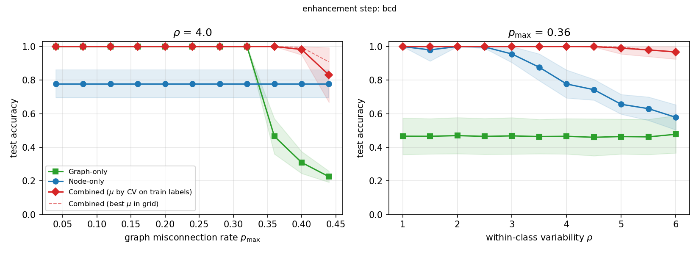

# CoGEnT-style solver for graph + node-information classification

Code for the atomic conditional-gradient solver of Appendix F (Algorithm 1) of
*When Graph Structure Provably Helps Classification* (NeurIPS 2026), and for the synthetic
experiment of Fig. 3 (center and right panels).

The solver minimizes the unified convex program (14). It combines:

* a **graph term**, the polarized adjacency $\bar A$ against the co-membership matrix $L$;
* **node losses** $f_v$ (any convex loss; the paper uses the label-aware loss (22));
* a **fusion term** $\gamma\sum_{u<v}\|\theta_u-\theta_v\|$.

The weight $\mu$ trades the graph term against the node terms. **All three regimes are the same
program and the same solver**; only $\mu$ changes:

| regime | $\mu$ |
| --- | --- |
| node information only | $\infty$ |
| graph only | $0$ |
| combined | $0<\mu<\infty$ |



*Left: accuracy vs graph misconnection rate $p_{\max}$ at feature diameter $\rho=4$. Right:
accuracy vs $\rho$ at $p_{\max}=0.36$. 20 trials, mean ± std. The combined regime ($\mu$ chosen
by cross-validation on the training labels only) is at or above both baselines everywhere, and
it recovers the classes where neither source alone does.*

## Where to start reading

| if you want to … | read |
| --- | --- |
| see **what changed** with respect to the original code, and why | [`CHANGES.md`](CHANGES.md) |
| understand the problem, the math of every step, and what the code computes | [`docs/solver_explained.md`](docs/solver_explained.md) |
| read the review of Appendix F and the suggested LaTeX fixes | [`docs/paper_notes/`](docs/paper_notes/) |
| read the solver | [`cogent/solver.py`](cogent/solver.py) (each step's docstring cites the paper's equations) |

## Repository layout

```
cogent/                      the solver package
  solver.py                  CoGEnT class: forward step, both enhancement steps, backward step, main loop
  losses.py                  NodeLoss interface, SquaredLoss, LabelAwareLoss (eq. (22))
  _numba_kernels.py          optional numba version of the default row sweep (same results)
  metrics.py                 clustering_accuracy (Hungarian matching)
experiments/
  synthetic.py               features with exact diameter rho, regular graphs with exact p_max
  fig3_sweeps.py             Fig. 3 (center, right): regimes, choice of mu by CV, plots and CSVs
tests/
  test_forward_rate.py       rate (115)-(116) vs finite differences, with and without ties
  test_general_loss.py       generic loss path (incl. a constrained Huber loss)
  test_enhancements.py       both enhancement options: Phi non-increasing, easy instance recovered
  check_vs_ground_truth.py   solver objective vs ground-truth partition (slow script)
docs/
  solver_explained.md        self-contained description: problem, derivations, code, results
  paper_notes/               review of App. F and suggested replacement text (LaTeX)
results/
  enhancement_bcd/           final run, default enhancement step (20 trials)
  enhancement_fw/            final run, Frank-Wolfe enhancement step of App. F.3 (10 trials)
```

Each results folder contains `fig3_sweeps.png`, the curves as space-separated CSVs (for
pgfplots), `fig3_raw.npy` (every solver job, including per-$\mu$ accuracies and CV scores) and
the run log.

## Installation

Python ≥ 3.9.

```bash
pip install -r requirements.txt
```

`numba` is optional. It speeds up the default enhancement step and gives identical results.

## Quick start

```python
import numpy as np
from cogent import CoGEnT, LabelAwareLoss

# X: (n, d) features, A: (n, n) 0/1 adjacency, y: labels (only y[train] is used), K classes
loss = LabelAwareLoss(X, y, train, n_classes=K, nu=2.0, a_radius=np.linalg.norm(X, axis=1).max())

res = CoGEnT(loss, A, gamma=2.0, mu=0.1).solve()            # combined
res = CoGEnT(loss, A, gamma=2.0, mu=np.inf).solve()         # node information only
res = CoGEnT(loss, A, gamma=2.0, mu=0.0).solve()            # graph only

res["y_pred"]      # predictions phi(theta_v), theta_v = sum_i omega_vi theta_i
res["Omega"], res["Theta"], res["k"], res["objective"], res["hist"]
```

### The two enhancement steps

```python
CoGEnT(loss, A, gamma, mu, enhancement="bcd")   # default
CoGEnT(loss, A, gamma, mu, enhancement="fw")    # Frank-Wolfe, as written in App. F.3
```

* **`"bcd"`** (block-coordinate descent): every row of $\Omega$ is replaced by the best of a few
  candidate rows, using the exact change of the objective; then a majorize–minimize step on the
  atoms. Used for the main figure.
* **`"fw"`**: Frank–Wolfe on the rows of $\Omega$ (row LMO (108)–(111)) and on the atoms (atom
  LMO (112)–(113)), each with a line search. It needs a compact parameter set; this is what the
  `a_radius` ball is for.

Both decrease the objective monotonically and give the same qualitative picture. `"fw"` is about
2× slower, and its node-only solutions are weaker when the classes fragment into many atoms.
See [`CHANGES.md`](CHANGES.md#4-enhancement-step-f3-two-options).

### Using your own node loss

Subclass `cogent.NodeLoss` and implement `values`, `pointwise`, `grad_atoms` and
`smoothness` (plus `project` if the parameter set is constrained, and `lmo` for
`enhancement="fw"`). Every other operation has a generic first-order fallback. See the docstring
of [`cogent/losses.py`](cogent/losses.py) and the Huber example in
[`tests/test_general_loss.py`](tests/test_general_loss.py).

## Reproducing the figures

From the repository root:

```bash
python experiments/fig3_sweeps.py --enhancement bcd --trials 20
```

```bash
python experiments/fig3_sweeps.py --enhancement fw --trials 10
```

On 11 worker processes the runs take about 93 min (BCD) and 103 min (FW). They write to
`results/enhancement_<option>/`. Other useful commands:

```bash
python experiments/fig3_sweeps.py --trials 1 --out results/smoke
```

```bash
python experiments/fig3_sweeps.py --replot --enhancement bcd
```

The first is a quick check; the second redraws the figure from the saved `fig3_raw.npy` without
solving. Runs are deterministic given the seeds, and this code reproduces the saved results
exactly.

## Tests

```bash
pytest tests/
```

```bash
python tests/check_vs_ground_truth.py
```

The second command is slow (a few minutes). It checks that on 45 instances the solver always
reaches an objective at least as low as that of the ground-truth partition.

## Citation

```bibtex
@inproceedings{graphstructure2026,
  title     = {When Graph Structure Provably Helps Classification},
  author    = {TODO},
  booktitle = {Advances in Neural Information Processing Systems (NeurIPS)},
  year      = {2026}
}
```
