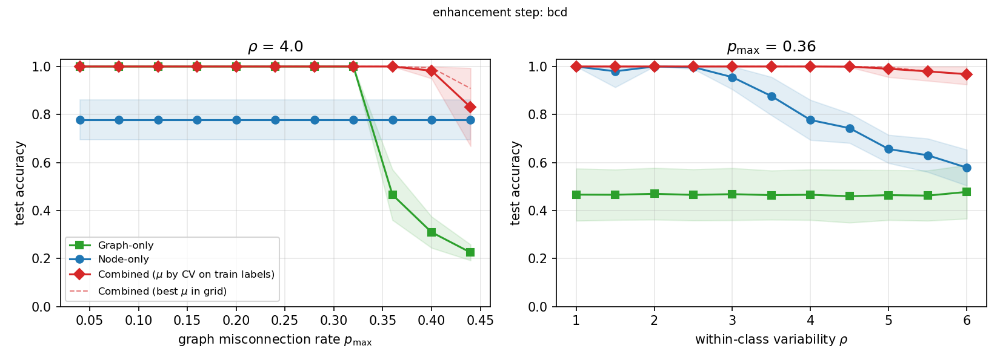

# What the code does: the CoGEnT-style solver and the Fig. 3 experiment

This document is self-contained. It states the optimization problem, derives every step of
the algorithm, and says exactly what the code computes, with all constants and heuristics.
It also describes the experiment behind Fig. 3 (center, right) and reports its results.
The math uses `$...$`; it renders on GitHub and in the VS Code Markdown preview.
Equation numbers refer to the paper. The list of changes with respect to the original code is
in [`CHANGES.md`](../CHANGES.md).

**Files**

| file | role |
| --- | --- |
| `cogent/solver.py` | the solver (`CoGEnT`, `cogent_solve`), both enhancement options |
| `cogent/losses.py` | the node-loss interface `NodeLoss` and the losses `SquaredLoss`, `LabelAwareLoss` (22) |
| `cogent/_numba_kernels.py` | the same Omega-row sweep as `CoGEnT._omega_sweep`, compiled with numba (used automatically if installed) |
| `cogent/metrics.py` | `clustering_accuracy` |
| `experiments/synthetic.py` | features with exact diameter $\rho$, graphs with exact $p_{\max}$ |
| `experiments/fig3_sweeps.py` | regimes, choice of $\mu$, plots/CSV of Fig. 3 |
| `tests/test_forward_rate.py` | checks the slope formula (Sec. 4.3) against finite differences |
| `tests/test_general_loss.py` | runs the solver through the generic loss interface (including a Huber loss) |
| `tests/test_enhancements.py` | both enhancement options: $\Phi$ never increases, easy instance recovered |
| `tests/check_vs_ground_truth.py` | compares the objective reached by the solver with the objective of the true partition (slow) |

## 0. Two clarifications up front

* **$\mu$ is not optimized inside the convex program.** For each instance the program is solved
  separately for every $\mu$ in a fixed grid $\{0.01, 0.03, 0.1, 1, 10, 100\}$. One of these values is
  then *selected* by cross-validation that uses only the observed training labels (Sec. 9.5).
  The test labels are never used for the selection. The dashed "best $\mu$" curve in the figure
  uses the test labels and is shown only as a reference: it is the empirical envelope over $\mu$,
  analogous to the envelope in Fig. 3 (left). $\gamma = 2$ and $\nu = 2$ are fixed and are not
  tuned.
* **The Huber loss is not used in any experiment.** It appears only in
  `tests/test_general_loss.py`, to show that the solver runs with a non-quadratic loss and a
  constrained parameter set through the generic interface. All experiments use the label-aware
  loss (22) of the paper (Sec. 1.4).

---

## 1. The problem

### 1.1 Data

* Graph $G=(\mathcal V,\mathcal E)$ with $n$ nodes and adjacency $A\in\{0,1\}^{n\times n}$.
* Polarized adjacency $\bar A_{uv} = +1$ if $\{u,v\}\in\mathcal E$ and $-1$ otherwise, for
  $u\neq v$. The code uses $\bar A^0$, which equals $\bar A$ with a **zero** diagonal (see 1.3).
* Node features $x_v\in\mathbb R^d$.
* Observed labels $\tilde y_v\in\{1,\dots,K\}$ for $v\in\mathcal V_{\rm train}$.
* For every node, a convex loss $f_v:\mathbb R^p\to(-\infty,\infty]$ of a parameter $\theta$.

### 1.2 The unified problem (14) and its lifted form (46)

Problem (14) of the paper is

$$
\min_{L\in\mathcal B',\ \{\theta_v\},\ \{\lambda_i\ge 0,(e_ie_i^\top,\theta_i)\in\mathcal A\}}
\ \|L-A\|_1+\mu n\Big(\sum_{v}\sum_i \lambda_i e_{i,v}^2 f_v(\theta_i)+\frac{\gamma}{n}\sum_{u<v}\|\theta_u-\theta_v\|_2\Big)
$$

subject to $L=\sum_i\lambda_ie_ie_i^\top$ and $\theta_v=\sum_i\lambda_ie_{i,v}^2\theta_i$. Here
$\mathcal B'=\{L=L^\top\succeq 0,\ 0\le L_{uv}\le 1,\ L_{vv}=1\}$.

Because $L_{uv}\in[0,1]$ and $A_{uv}\in\{0,1\}$,
$|L_{uv}-A_{uv}| = A_{uv}+L_{uv}(1-2A_{uv})$. Hence

$$
\|L-A\|_1 = \text{const}-\langle \bar A, L\rangle
= \text{const}-\sum_{u\ne v}\bar A^0_{uv}L_{uv},
$$

since $L_{vv}=1$ makes the diagonal a constant. This is the polarized program (46).

### 1.3 Reduced parameterization and the objective implemented in the code

The code keeps a finite active set of $k$ atoms:

* **atom parameters** $\Theta\in\mathbb R^{k\times p}$, row $i$ is $\theta_i\in\Theta_f$;
* **node–atom weights** $\Omega\in\mathbb R^{n\times k}_{\ge 0}$, with $\omega_{v,i}=\lambda_ie_{i,v}^2$.
  Every row of $\Omega$ lies in the simplex $\Delta^k$; this is exactly the constraint $L_{vv}=1$.

From these:

$$
E=\sqrt{\Omega}\ \text{(entrywise)},\qquad L(\Omega)=EE^\top,\qquad
\theta_v=\sum_i\omega_{v,i}\theta_i\quad(\text{the matrix } T=\Omega\Theta).
$$

$L$ is automatically symmetric PSD, has unit diagonal and satisfies $0\le L_{uv}\le 1$
(Cauchy–Schwarz, $E\ge0$). Because $E \ge 0$, the atoms are restricted to $e\ge 0$. This is a
convex restriction of (46): the completely positive cone instead of the PSD cone. The
perfect-recovery solution has $e\ge 0$.

The code minimizes the paper's reduced objective (104) **divided by $n\mu$**:

$$
\boxed{\ \Phi(\Omega,\Theta)= -w_g\sum_{u\ne v}\bar A^0_{uv}L_{uv}
+ w_f\sum_{v,i}\omega_{v,i}f_v(\theta_i)
+ w_s\sum_{u<v}\|\theta_u-\theta_v\|_2\ }
$$

| regime | $w_g$ | $w_f$ | $w_s$ |
| --- | --- | --- | --- |
| combined, $0<\mu<\infty$ | $1/(n\mu)$ | $1$ | $\gamma/n$ |
| node only, $\mu=\infty$ | $0$ | $1$ | $\gamma/n$ |
| graph only, $\mu=0$ | $1$ | $0$ | $0$ |

Code: `CoGEnT.__init__` sets $(w_g,w_f,w_s)$ = `(wg, wf, ws)`; `CoGEnT.objective` evaluates $\Phi$.
It caches $E$, $F_{v,i}=f_v(\theta_i)$, $T=\Omega\Theta$ and $\bar A^0E$, and uses
$\sum_{u\ne v}\bar A^0_{uv}L_{uv}=\langle E,\bar A^0E\rangle$.

**Graph only.** The search uses only the graph term. After it converges, the atom parameters are
computed with $(w_f,w_s)=(1,\gamma/n)$ for the final $\Omega$ (Sec. 7). This is the
$\mu\to0^+$ limit of (14): $\Omega$ is determined by the graph, and $\Theta$ is the minimizer of
the node terms given $\Omega$.

### 1.4 Node losses

**Used in the experiments: label-aware loss (22).** The parameter is $\theta=(a,\pi)$ with
$a\in\mathbb R^d$ and $\pi\in\Delta^{K-1}$, so $p=d+K$ and $\Theta_f=\mathbb R^d\times\Delta^{K-1}$:

$$
f_v(a,\pi)=\tfrac12\|x_v-a\|_2^2-\nu\,\mathbf 1\{v\in\mathcal V_{\rm train}\}\,\pi_{\tilde y_v},
\qquad \phi(\theta)=\arg\max_c \pi_c .
$$

* The fusion term acts on the *whole* $\theta=(a,\pi)$, as in (14).
* Label information reaches test nodes through the label term of the training nodes that share
  their atoms, and through the fusion term.
* In `decode`, ties in $\arg\max_c\pi_c$ are broken uniformly at random with a fixed seed.

**Other losses.**

* `SquaredLoss` implements $f_v=\tfrac12\|x_v-\theta\|^2$, i.e. problem (3).
* `NodeLoss` is the generic interface. A new loss must provide:
  * `values` ($f_v(\theta_i)$ for all $v,i$);
  * `pointwise` ($f_v(\theta_v)$);
  * `grad_atoms` ($\sum_v W_{v,i}\nabla f_v(\theta_i)$);
  * `smoothness` (a Lipschitz constant of $\nabla f_v$);
  * `project`, if $\Theta_f\neq\mathbb R^p$.

  Every other operation has a generic first-order fallback: the oracles (117) and (121) and the
  $\Theta$-step. `tests/test_general_loss.py` checks two things. Running the squared loss
  through the generic fallbacks gives the same objective as the closed forms. A Huber loss
  constrained to a ball runs and stays feasible.

---

## 2. The algorithm at a glance

```
initialize   k = 1,  Omega = 1_n,  theta_1 = argmin_theta sum_v f_v(theta)        (Sec. 3)
repeat (at most max_outer = 2n times):
    Phi_prev = Phi
    forward step:      oracle -> 6 candidate atoms (S, theta) ranked by rate (115);
                       exact line search along (114); add the best atom if Phi decreases  (Sec. 4)
    enhancement step:  3 cycles of [Omega row sweep; drop empty atoms; Theta step]  (Sec. 5)
    Phi_post = Phi
    backward step:     delete atoms while Phi <= eta*Phi_prev + (1-eta)*Phi_post    (Sec. 6)
    stop if no atom was added and Phi decreased by less than 1e-9 (relative)
final:  6 enhancement cycles;  graph only: compute Theta for the final Omega          (Sec. 7)
output: assignment c(v) = argmax_i omega_{v,i},  prediction phi(theta_{c(v)})
```

Every step either decreases $\Phi$ or leaves it unchanged (Sec. 8.1).

## 3. Initialization (Algorithm 1, lines 1–2)

$k=1$, $\Omega=\mathbf 1_n$ (every node fully on one atom, so $L=\mathbf 1\mathbf 1^\top$), and
$\theta_1=\arg\min_\theta\sum_vf_v(\theta)$.

For (22) this gives:

* $a_1=\bar x$, the mean of the features;
* $\pi_1=\arg\min_{\pi\in\Delta}-\nu\sum_c N_c\pi_c$, where $N_c$ is the number of training
  labels of class $c$. With balanced labels all $N_c$ are equal, so the minimizing face is the
  whole simplex and the code takes its barycenter, $\pi_1=\frac1K\mathbf 1$.

Code: `CoGEnT.solve`, `weighted_argmin`, `simplex_argmin_linear` (ties share mass uniformly).

---

## 4. Forward step (App. F.4): adding one atom

### 4.1 What the forward step does, and why

The current point is $(\Omega,\Theta)$ with $k$ atoms. The forward step tries to add **one new
atom** that lowers $\Phi$. A new atom is described by three things:

* its parameter, which in this section is written $\vartheta\in\Theta_f$ to distinguish it from
  the existing $\theta_i$ and $\theta_v$;
* the set $S\subseteq\mathcal V$ of nodes that move to it;
* the step $t\in[0,1]$: every node of $S$ moves the fraction $t$ of its mass to the new atom.
  Nodes outside $S$ do not change.

The ideal choice is the $(S,\vartheta,t)$ with the smallest $\Phi$. That cannot be searched
directly: there are $2^n$ sets $S$, and $\Phi$ is nonlinear in all three.

The algorithm therefore splits the choice in two, as Frank–Wolfe / CoGEnT does:

1. **Choose $(S,\vartheta)$ from a first-order model.** For a candidate, the slope
   $R(S,\vartheta):=\frac{d}{dt}\Phi\big|_{t=0^+}$ says how fast $\Phi$ starts to change when mass
   begins to flow to the new atom. A negative slope means a small step helps. The oracle searches
   for candidates with very negative slope (Sec. 4.4).
2. **Choose $t$ on the exact objective.** For the 6 best candidates, $\Phi(t)$ itself is
   minimized over $t\in(0,1]$. The best one is added only if $\Phi$ really decreases (Sec. 4.5).

The slope only *proposes* candidates; the exact objective *decides*. Sections 4.2–4.3 derive
$\Phi(t)$ and its slope.

**Why every node of $S$ moves the same fraction ($u_v\in\{0,1\}$).** Path (114) of the paper
allows a node-dependent fraction $u_v\in[0,1]$. The code uses $u=\mathbf 1_S$ for three reasons:

* the target is a partition, i.e. full moves;
* the amount is set by $t$ and refined afterwards by the enhancement step;
* with $u\in\{0,1\}$ the slope becomes a quadratic function of the set $S$, which can be searched
  (Sec. 4.4).

**Why compare candidates at the full step.** The paper normalizes $\|e\|_2=1$ and compares the
slope per unit $\rho$. The maximal step then depends on $e$, so candidates are compared at
different distances, and atoms concentrated on one or two nodes are favoured. With $u=\mathbf 1_S$
and $t\in[0,1]$, every candidate's full step is $t=1$. This is the Frank–Wolfe comparison at the
boundary of the feasible set.

### 4.2 The objective along the path, written out

For $t\in[0,1]$ the new point is:

$$
\text{for } v\in S:\quad \omega_{v,i}(t)=(1-t)\,\omega_{v,i}\ (i\le k),\qquad \omega_{v,k+1}(t)=t,
$$

$$
\text{for } v\notin S:\quad \omega_{v,i}(t)=\omega_{v,i},\qquad \omega_{v,k+1}(t)=0 .
$$

Each row still sums to one. The objective (Sec. 1.3) has three terms; here is each one as a
function of $t$.

**(a) Graph term.** Since $E=\sqrt\Omega$:

* for $v\in S$, $E_{v,i}(t)=\sqrt{1-t}\,E_{v,i}$ and $E_{v,k+1}(t)=\sqrt t$;
* for $v\notin S$, $E_{v,:}$ is unchanged and $E_{v,k+1}=0$.

The entries $L_{vw}(t)=\sum_iE_{v,i}(t)E_{w,i}(t)$ are therefore

$$
L_{vw}(t)=\begin{cases}
L_{vw}, & v\notin S,\ w\notin S,\\[2pt]
\sqrt{1-t}\;L_{vw}, & \text{exactly one of } v,w \text{ in } S,\\[2pt]
(1-t)\,L_{vw}+t, & v\in S,\ w\in S .
\end{cases}
$$

Define four constants, all sums over ordered pairs $v\ne w$:

* $C_{\rm out}=\sum_{v,w\notin S}\bar A^0_{vw}L_{vw}$;
* $C_{\times}=\sum_{v\in S,\,w\notin S}\bar A^0_{vw}L_{vw}$;
* $C_{\rm in}=\sum_{v,w\in S}\bar A^0_{vw}L_{vw}$;
* $N_{\rm in}=\sum_{v,w\in S}\bar A^0_{vw}$.

$N_{\rm in}$ is twice the number of edges minus non-edges inside $S$. Then

$$
\text{graph}(t)=-w_g\Big[C_{\rm out}+2\sqrt{1-t}\;C_\times+(1-t)\,C_{\rm in}+t\,N_{\rm in}\Big].
$$

The factor 2 counts the two orders $(v,w)$ and $(w,v)$ of a cross pair.

**(b) Lifted node loss.** With $\ell_v=\sum_i\omega_{v,i}f_v(\theta_i)$, the current loss of
node $v$:

$$
\text{loss}(t)=w_f\sum_{v\notin S}\ell_v+w_f\sum_{v\in S}\big[(1-t)\,\ell_v+t\,f_v(\vartheta)\big].
$$

**(c) Fusion term.** The node parameter is $\theta_v(t)=\sum_i\omega_{v,i}(t)\theta_i$:

* for $v\in S$, $\theta_v(t)=(1-t)\theta_v+t\vartheta=\theta_v+t(\vartheta-\theta_v)$;
* for $v\notin S$, $\theta_v(t)=\theta_v$.

With $z_{vw}=\theta_v-\theta_w$ (current difference), each pair behaves as follows:

$$
\theta_v(t)-\theta_w(t)=\begin{cases}
z_{vw}, & v,w\notin S,\\[2pt]
(1-t)\,z_{vw}, & v,w\in S,\\[2pt]
z_{vw}+t\,(\vartheta-\theta_v), & v\in S,\ w\notin S,
\end{cases}
\qquad
\text{fusion}(t)=w_s\sum_{v<w}\|\theta_v(t)-\theta_w(t)\|_2 .
$$

So

$$
\Phi(t)=\text{graph}(t)+\text{loss}(t)+\text{fusion}(t).
$$

This exact function is what the line search minimizes (`_path_objective`).

* The loss is linear in $t$.
* The fusion term is convex in $t$: a sum of norms of affine functions.
* The graph term contains $\sqrt{1-t}$. It is convex if $C_\times>0$ and concave if $C_\times<0$.
  So without the graph (node only) $\Phi(t)$ is convex, and with the graph it need not be.

### 4.3 The slope $R=\Phi'(0^+)$: differentiating term by term

**(a) Graph.** Using $\frac{d}{dt}2\sqrt{1-t}\big|_{0}=-1$:

$$
\text{graph}'(0)=-w_g\big[-C_\times-C_{\rm in}+N_{\rm in}\big]
=-w_g\,N_{\rm in}+w_g\sum_{v\in S}(\bar A^0L)_{vv},
$$

since $C_\times+C_{\rm in}=\sum_{v\in S}\sum_{w\ne v}\bar A^0_{vw}L_{vw}=\sum_{v\in S}(\bar A^0L)_{vv}$.

* *Gain:* inside $S$ the new block has $L=1$. Edges inside $S$ lower $\Phi$ and non-edges raise
  it, through $-w_gN_{\rm in}$.
* *Loss:* each moved node $v$ starts losing what it currently gets from its similarities,
  $(\bar A^0L)_{vv}$.

**(b) Loss.** It is linear, so

$$
\text{loss}'(0)=w_f\sum_{v\in S}\big(f_v(\vartheta)-\ell_v\big).
$$

A node wants to move if the new parameter fits it better than its current atoms.

**(c) Fusion.** Differentiate each pair, using $\frac{d}{dt}\|z+t\delta\|\big|_{0}=\langle z/\|z\|,\delta\rangle$ if
$z\ne0$, and $=\|\delta\|$ if $z=0$. For a pair with exactly one node in $S$, call that node $v$:

| pair | $\frac{d}{dt}\|\theta_v(t)-\theta_w(t)\|$ at $t=0$ |
| --- | --- |
| $v,w\notin S$ | $0$ |
| $v,w\in S$ | $-\|z_{vw}\|$ (the pair moves closer together) |
| $v\in S,\ w\notin S$, $\theta_v\ne\theta_w$ | $\langle g_{vw},\vartheta-\theta_v\rangle$, with $g_{vw}=z_{vw}/\|z_{vw}\|$ |
| $v\in S,\ w\notin S$, $\theta_v=\theta_w$ (**tied**) | $\|\vartheta-\theta_v\|$ |

The last row is the one that matters here. If $v$ and $w$ currently have the *same* parameter
(for example, both sit fully on the same atom) and only $v$ moves, the pair is pulled apart and
$\|\theta_v(t)-\theta_w(t)\|=t\,\|\vartheta-\theta_v\|$ grows linearly from $0$.

**(d) The slope.** Adding (a)–(c):

$$
\boxed{R(S,\vartheta)=\sum_{v\in S}d_v(\vartheta)\;-\;w_g\!\!\sum_{v\ne w\in S}\!\bar A^0_{vw}
\;+\;w_s\!\!\sum_{\substack{v\in S,\ w\notin S\\ \theta_v=\theta_w}}\!\!\|\vartheta-\theta_v\|_2}
$$

$$
d_v(\vartheta)=w_f\big(f_v(\vartheta)-\ell_v\big)+w_s\langle G_v,\vartheta-\theta_v\rangle+w_g(\bar A^0L)_{vv},
\qquad G_v=\sum_{w\ne v,\ \theta_w\ne\theta_v}g_{vw}.
$$

Here $\sum_{v\in S}\langle G_v,\vartheta-\theta_v\rangle$ collects the untied rows of the table.
For an untied pair inside $S$ the two terms combine to
$\langle g_{vw},\vartheta-\theta_v\rangle+\langle g_{wv},\vartheta-\theta_w\rangle=-\|z_{vw}\|$.

**Relation to the paper.** Without the last (tie) term this is the paper's rate (115)–(116),
written for $u=\mathbf 1_S$. The paper's formula is therefore exact when no two node parameters
coincide, and it **misses the tie term** otherwise.

**Small example.** Two nodes on the same atom have $\theta_1=\theta_2=a$.

* Moving only node 1 to $\vartheta$: $\|\theta_1(t)-\theta_2(t)\|=t\|\vartheta-a\|$, slope
  $w_s\|\vartheta-a\|>0$. Formula (115) uses $g_{12}=0$ and predicts $0$.
* Moving both: the difference stays $0$, slope $0$.

So splitting a fused pair has a first-order cost, and moving it together does not. At hard
assignments every class is a tied group of 25 nodes, and moving $m$ of them costs
$w_s\,m(25-m)\|\vartheta-a\|$.

**Numerical check** (`tests/test_forward_rate.py`), slope vs. finite difference of $\Phi(t)$:

* random soft points (no ties): relative error $\le1.5\cdot10^{-6}$;
* hard assignments (ties): (115) alone has errors up to $4.2$ (relative), including a wrong
  sign ($-7.76$ predicted, $+2.45$ actual). With the tie term the error is $2.4\cdot10^{-6}$.

**Code.**

* `_rate_terms` gives $G_v$ and the part of $d_v$ that does not depend on $\vartheta$;
* `_d_of_theta` gives $d_v(\vartheta)$;
* `_rate_of_set` evaluates the rate without the tie term (the paper's (115), used by the oracle);
* `exact_rate` adds the tie term (pairs with $\|\theta_v-\theta_w\|\le10^{-12}$). It is used by the
  tests, not by the oracle (Sec. 4.4).

### 4.4 Choosing the new atom: the oracle (`_lmo`)

**What we want.** The pair $(S,\vartheta)$ with the most negative slope. In the code the slope is
the paper's rate (115)–(116) for $u=\mathbf 1_S$, i.e. $R$ of Sec. 4.3 **without** the tie term:

$$
R_{115}(S,\vartheta)=\sum_{v\in S}d_v(\vartheta)-w_g\sum_{v\ne w\in S}\bar A^0_{vw}.
$$

This is the linear-minimization-oracle step of CoGEnT: pick the atom along which the objective
starts to decrease fastest. Why the tie term is not needed here is explained at the end of this
section.

**What makes a good new atom.** Read off the formula, the nodes of $S$ should:

* fit $\vartheta$ better than their current atoms ($f_v(\vartheta)<\ell_v$);
* be pulled towards $\vartheta$ by the fusion term ($\langle G_v,\vartheta-\theta_v\rangle<0$);
* be densely connected among themselves (edges inside $S$, through $-w_g\bar A^0_{vw}$);
* be weakly tied to their current blocks (small $(\bar A^0L)_{vv}$).

In short, $S$ is a well-connected group of nodes that the new parameter fits better than the
current atoms do.

**Why it needs a heuristic.** $R_{115}$ depends on two unknowns:

* *for fixed $S$*, the best $\vartheta$ solves a small convex problem (eq. (121), `_theta_oracle`):
  $\vartheta=\arg\min_\vartheta\sum_{v\in S}\big[w_ff_v(\vartheta)+w_s\langle G_v,\vartheta\rangle\big]$.
  For (22) it has a closed form: the feature part is the mean of $x_v$ over $S$, shifted by the
  fusion pull, and the label part is the majority training label in $S$ (also corrected by the
  fusion pull);
* *for fixed $\vartheta$*, choosing $S$ means picking a group of nodes. A node $v$ alone
  contributes $d_v$, and each pair inside $S$ contributes $-w_g\bar A^0_{vw}$. This is a quadratic
  function of the 0/1 vector $\mathbf 1_S$, and minimizing such functions is NP-hard in general
  (it contains densest-subgraph). There are $2^n$ candidate sets.

The code therefore searches heuristically, in three steps.

**Step 1: a score for every node, before $\vartheta$ is known.** $d_v$ depends on $\vartheta$,
and $\vartheta$ depends on $S$. To break this circle, every node first gets its *own* best
parameter $\vartheta_v=\arg\min_\vartheta w_ff_v(\vartheta)+w_s\langle G_v,\vartheta\rangle$
(eq. (117)), with score $s_v=d_v(\vartheta_v)$ (eq. (118)). This is the most favourable value
$d_v$ can take, so a very negative $s_v$ marks a node that wants to move somewhere.

**Step 2: starting groups.**

* *Spectral* (the paper's (119)). Replace $\mathbf 1_S$ by a real vector $x$. Minimizing
  $\sum_vs_vx_v^2-w_g\,x^\top\bar A^0x$ over unit vectors means maximizing
  $x^\top(w_g\bar A^0-\mathrm{diag}(s))x$, whose solution is the leading eigenvector. Its large
  entries mark nodes that are connected to each other *and* have low scores. The code takes the 3
  leading eigenvectors, both signs, and keeps the nonnegative part. Each vector is rounded to a set
  by keeping its $j$ largest entries, choosing the $j$ with the smallest $R_{115}$ (`_sweep_set`).
* *Single nodes.* The 3 nodes with the smallest $s_v$. Without a graph (node only) the
  eigenvectors carry no information, and a group is grown from its most eager node.

**Step 3: improve each start by alternating** (at most 4 rounds):

* $\vartheta\leftarrow$ the best parameter for the current $S$ (eq. (121));
* $S\leftarrow$ improved by single-node flips: repeatedly add or remove the one node that most
  decreases $R_{115}$, until no flip helps (`_local_search`). With
  $a_v=w_g\sum_{w\in S}\bar A^0_{vw}$, adding $v\notin S$ changes $R_{115}$ by $d_v-2a_v$, and
  removing $v\in S$ changes it by $-(d_v-2a_v)$.

Every start yields a candidate $(R_{115},S,\vartheta)$. Duplicates are removed and the
candidates are sorted by $R_{115}$. The **6 most negative** go to the line search (Sec. 4.5). If
none is negative, no atom is added.

**Why line-search 6 candidates instead of 1, and why the tie term is not used here.** The slope
is a first-order model. It predicts $\Phi$ only for small steps, and at tied parameters it is not
even the exact derivative (Sec. 4.3). The steepest candidate is therefore not always one that
lowers $\Phi$ at any useful step.

In the stall that the first version hit ($p_{\max}=0.36$, $\mu=0.03$, 2 atoms):

* the 3 steepest candidates had slopes around $-200$ (exact slopes around $-120$), yet $\Phi$ did
  not decrease anywhere on the step grid;
* candidates 4–6 would each have lowered $\Phi$ by about 200.

Evaluating several candidates on the exact $\Phi$ fixes this. The ablation below shows that this
is what matters, and that using the exact (tie-aware) slope to rank candidates does not help.

| oracle variant | runs with $\Phi(\text{solver})>\Phi(\text{truth})$ (of 45) | mean $\Phi$ above best variant | node-only acc. at $\rho=1$ / $1.5$ |
| --- | --- | --- | --- |
| rate (115), 3 candidates line-searched (first version) | 2 (by up to 302) | 15.2 | 1.00 / 0.66 |
| **rate (115), 6 candidates (final)** | **0** | **0.39** | 1.00 / 0.66 |
| exact rate (with tie term), 6 candidates | 0 | 0.99 | 0.83 / 0.60 |
| both rankings, 3 + 3 candidates | 0 | 0.47 | 1.00 / 0.74 |

The 45 instances are those of Sec. 8.3; the node-only rows add 4 seeds at $\rho=1$ and $1.5$.
This ablation was run with an earlier version of the experiment (before the decoding fix of
Sec. 7, the ball on $a$, and the random graph order), so its absolute accuracies differ from the
final runs in Sec. 10; only the comparison between the oracle variants matters here.

Ranking by the exact slope is worse. With the tie term, adding one member of a fused group to $S$
costs that node's whole tie penalty, so the flip search rarely splits off part of a group, even
when the finished split would lower $\Phi$. The final code uses the paper's rate (115) to rank and
the exact objective to decide.

"Both rankings" gives a higher node-only accuracy at $\rho=1.5$ (0.74 vs 0.66). That is the
fragmenting regime, though, and accuracy is not what the solver optimizes. On the objective, the
final variant is slightly better (0.39 vs 0.47), and it is simpler.

### 4.5 Line search and update (`_forward`, `_path_objective`)

For each candidate, $\Phi(t)$ of Sec. 4.2 is evaluated exactly:

1. on the grid $t\in\{0.05,0.10,\dots,1\}$ (20 points);
2. then 12 golden-section steps around the best grid point.

The candidate and step with the smallest $\Phi$ are kept. The atom is appended (new column
$t\,\mathbf 1_S$ in $\Omega$, new row $\vartheta$ in $\Theta$) only if $\Phi$ decreases (relative
tolerance $10^{-12}$); otherwise nothing is added. The forward step therefore never increases
$\Phi$. Atoms are not added once $k$ reaches `max_atoms` (the experiments use $n$, i.e. no cap).

---

## 5. Enhancement step (App. F.3): refining the active set

With $k$ fixed, $\Phi$ is **not** jointly convex. For a non-edge, the graph term contributes
$+w_g\sqrt{\omega_{u,i}\omega_{w,i}}$, which is concave. In the fusion term
$\|\sum_i(\omega_{u,i}-\omega_{w,i})\theta_i\|$ the argument of the norm is bilinear in
$(\Omega,\Theta)$. $\Phi$ *is* convex in $\Theta$ for fixed $\Omega$. The code
therefore uses block-coordinate descent and accepts a change only if $\Phi$ decreases.

One enhancement cycle (`_inner`) is: Omega row sweep → drop atoms with zero mass → $\Theta$-step.
Each outer iteration runs 3 cycles, stopping early when a cycle decreases $\Phi$ by less than
$10^{-9}$ (relative).

### 5.1 Omega row sweep (`_omega_sweep`, `_numba_kernels.omega_sweep`)

Rows are visited in a random order (seeded). For row $v$:

**Direction scores.** These only choose which candidates to evaluate. They are the partial
derivatives (105):

$$
D_i = w_fF_{v,i}-w_g\frac{(\bar A^0E)_{v,i}}{\max(E_{v,i},10^{-8})}+w_s\langle\theta_i,G_v\rangle .
$$

**Candidate rows.**

* Full moves (simplex vertices) $\delta_i$ for the 6 atoms with the smallest $D_i$ together with
  the current support of $\omega_v$. All $k$ vertices are tried when $k\le6$.
* Frank–Wolfe points $(1-\alpha)\omega_v+\alpha\delta_{i^\star}$ with $\alpha\in\{0.25,0.5\}$ and
  $i^\star=\arg\min D$.
* Pairwise points: move the fraction $\beta\in\{0.5,1\}$ of $\omega_{v,j}$ from
  $j=\arg\max_{i\in\text{supp}}D_i$ to $i^\star$ (when $j\ne i^\star$).

**Exact change of $\Phi$** for a candidate row $\omega'$, with $E'_v=\sqrt{\omega'}$. Only row and
column $v$ of $L$ and $\theta_v$ change:

$$
\delta\Phi=-2w_g\,(E'_v-E_v)\cdot(\bar A^0E)_{v,:}
+w_f\,(\omega'-\omega_v)\cdot F_{v,:}
+w_s\sum_{w\ne v}\big(\|\omega'\Theta-\theta_w\|-\|\theta_v-\theta_w\|\big).
$$

The first term uses $\sum_{u\ne w}\bar A^0_{uw}L_{uw}$, $L_{vw}=E_v\cdot E_w$, $\bar A^0_{vv}=0$
and the symmetry of $\bar A^0$.

**Update.** The best candidate is taken if $\delta\Phi<-10^{-12}$. The cache is updated
incrementally: $\bar A^0E \mathrel{+}= \bar A^0_{:,v}(E'_v-E_v)^\top$, together with $T_v$.

The cost per row is $O(n(k+p))$ for each of at most about $k_{\rm cand}\approx 10$ candidates.
The numba kernel performs exactly the same operations. On four test instances it gave the same
objective, atom count and accuracy as the numpy loop.

### 5.2 $\Theta$-step (`_theta_step`, `minimize_quadratic_surrogate`)

For fixed $\Omega$ the code minimizes
$\Psi(\Theta)=w_f\sum_{v,i}\omega_{v,i}f_v(\theta_i)+w_s\sum_{u<w}\|(\omega_u-\omega_w)\Theta\|$
by **majorize–minimize**. The graph term does not depend on $\Theta$.

* Pairs with $\omega_u=\omega_w$ contribute $0$ for every $\Theta$ and are dropped.
* For the other pairs, let $c_{uw}=\max(\|T^0_u-T^0_w\|,\ 10^{-6}\max(1,\max\|T^0_u-T^0_w\|))$ at
  the current $T^0=\Omega\Theta^0$. Since $\|z\|\le\frac{\|z\|^2}{2c}+\frac c2$ for any $c>0$,

$$
\Psi(\Theta)\le w_f\sum_{v,i}\omega_{v,i}f_v(\theta_i)+\frac{w_s}{2}\operatorname{tr}(\Theta^\top Q\Theta)+\text{const},
\qquad Q=\Omega^\top\mathcal L_W\Omega .
$$

Here $\mathcal L_W$ is the graph Laplacian with weights $W_{uw}=1/c_{uw}$, and
$\sum_{u<w}W_{uw}\|(\omega_u-\omega_w)\Theta\|^2=\operatorname{tr}(\Theta^\top\Omega^\top\mathcal L_W\Omega\Theta)$.

The surrogate separates over the coordinates of $\theta$. For (22):

* **Feature block.** Solve $\big(w_f\,\mathrm{diag}(m)+w_sQ\big)A=w_f\,\Omega^\top X$, where
  $m_i=\sum_v\omega_{v,i}$. This is a $k\times k$ linear system.
* **Label block.** Minimize $-w_f\nu\langle B,\Pi\rangle+\frac{w_s}{2}\operatorname{tr}(\Pi^\top Q\Pi)$
  with $B=\Omega^\top Y$ (training one-hots) and every row of $\Pi$ in the simplex. The code uses
  accelerated projected gradient with step $1/(w_s\lambda_{\max}(Q))$, at most 40 iterations,
  stopping early on small changes. The result is kept only if this block's surrogate decreased.

The new $\Theta$ is accepted only if $\Psi$ (the true value, not the surrogate) decreases. The
code does up to 5 such MM iterations per $\Theta$-step and stops when the decrease is below
$10^{-9}$ (relative).

For a general loss, the generic fallback runs 200 accelerated projected-gradient iterations on
the surrogate. Its step is $1/(w_f\cdot\text{smoothness}\cdot\max_im_i+w_s\lambda_{\max}(Q))$.
It keeps the result only if the surrogate decreased.

### 5.3 Alternative: the Frank–Wolfe enhancement step written in App. F.3 (`enhancement="fw"`)

The code also implements F.3 as written (`CoGEnT(..., enhancement="fw")`). One inner cycle is
Algorithm 1, lines 8–14: one Frank–Wolfe step on all rows of $\Omega$, then one on all atoms.

**Rows of $\Omega$** (`_fw_omega_step`).

1. Compute the partial derivatives (105) for every row:
   $D_{v,i}=w_fF_{v,i}-w_g(\bar A^0E)_{v,i}/\max(E_{v,i},\varepsilon)+w_s\langle\theta_i,G_v\rangle$,
   with $\varepsilon=10^{-8}$.
2. The row LMO (108)–(109) gives the vertex $\delta_{i^\star_v}$ with $i^\star_v=\arg\min_iD_{v,i}$.
3. All rows move together, $\Omega\leftarrow(1-\alpha)\Omega+\alpha S$ (eq. (111)), where
   $\alpha\in(0,1]$ is found by line search on the exact $\Phi$ (10-point grid, then 10
   golden-section steps).
4. The step is taken only if $\Phi$ decreases.

**Atoms** (`_fw_theta_step`).

1. Compute the gradient (106):
   $g_i=w_f\sum_v\omega_{v,i}\nabla f_v(\theta_i)+w_s(\Omega^\top G)_i$.
2. The atom LMO (112) over $\Theta_f$ gives, for loss (22) with $\Theta_f=\{\|a\|\le R\}\times\Delta$:
   * $a=-R\,g^a_i/\|g^a_i\|$;
   * $\pi$ = the simplex vertex with the smallest $g^\pi_i$.
3. All atoms move together, $\Theta\leftarrow(1-\alpha)\Theta+\alpha\tilde\Theta$ (eq. (113)), with
   $\alpha$ found by line search, and the step is taken only if $\Phi$ decreases.

**Step-size search.** The line search evaluates $\Phi$ on the fixed grid
$\alpha\in\{0.001,0.002,0.005,0.01,0.02,0.05,0.1,0.15,\dots,1\}$ in one vectorized call, then refines
with 4 golden-section steps. Frank–Wolfe often needs small steps, and the earlier grid of 10
equally spaced points missed them. The experiments use 3 cycles per outer iteration.

On 18 test instances, this fine grid with 3 cycles reached a lower objective than 10 cycles with
the coarse grid (gap to the best found 6 vs 20) and was 17% faster. Fewer cycles saves more time
but costs objective (2 cycles: gap 10). Most of the remaining time goes into the many outer
iterations of the fragmenting regimes, not the enhancement step.

**The two changes needed to run F.3.**

1. *A bounded set for $a$.* With $\Theta_f=\mathbb R^d\times\Delta$ the atom LMO (112) has no
   solution: a linear function is unbounded below on $\mathbb R^d$. The code uses
   $\|a\|\le R$ with $R=\max_v\|x_v\|$, i.e. $f_v=\ell_v+I_{\Theta}$ as allowed in Sec. 3.3. At hard
   assignments this constraint is inactive: replacing each $a_i$ by its projection onto the convex
   hull of the data lowers the loss and cannot increase $\|a_i-a_j\|$. The same constraint is used
   in the default (`bcd`) runs, so both variants solve the same problem.
2. *Step size by line search*, the option F.3 itself mentions. The fixed step $2/(t+2)$ can
   increase $\Phi$, and Frank–Wolfe's convergence theory does not cover this objective: the
   fusion term is nonsmooth, and the graph derivative (105) is unbounded as $e_{i,v}\to0$. With
   the line search every step is monotone.

**Behaviour** (results in Sec. 10).

* It is about 3.3× slower than the default.
* Rows of $\Omega$ stay soft (mixtures over several atoms) much longer. This is why the prediction
  must use the node parameter $\theta_v$ (Sec. 7), not the largest-weight atom.
* With the safeguard $\varepsilon=10^{-8}$ in (105), the graph decides the row direction even
  when its weight is tiny. At $\mu=100$, FW therefore ends about 4.5 above the node-only objective
  (Sec. 10.4). With $\varepsilon=10^{-2}$ the gap disappears.

### 5.4 Dropping empty atoms

Atoms with $\sum_v\omega_{v,i}\le10^{-12}$ are removed and the rows are renormalized. This
changes $\Phi$ only by the removed mass (at most $10^{-12}$ per atom).

---

## 6. Backward step (App. F.5): truncation (`_backward`)

Let $\Phi_{\rm prev}$ be the objective at the start of the outer iteration and $\Phi_{\rm post}$
the objective after the forward and enhancement steps. Rule (123) with $\eta=0.5$ accepts a
deletion if

$$
\Phi_{\text{after deletion}}\le \eta\,\Phi_{\rm prev}+(1-\eta)\Phi_{\rm post}.
$$

Procedure (as in CoGEnT's Algorithm 2, a cheap screen chooses the candidate):

1. **Candidates.** The 4 lightest atoms (smallest $\sum_v\omega_{v,i}$) and the 4 atoms whose
   parameter is closest to another atom's parameter.
2. **Cheap screen.** For each candidate $j$, delete it and evaluate $\Phi$ without
   re-optimizing. Deletion renormalizes each row proportionally. A row that sat entirely on $j$
   moves to the remaining atom whose $\theta$ is closest to $\theta_j$.
3. **Test.** Re-optimize the best candidate with one enhancement cycle, then apply the rule. If
   accepted, repeat from 1 with the same threshold. Otherwise restore the previous state and stop.

---

## 7. Termination and output

* The outer loop stops when no atom was added and $\Phi$ decreased by less than $10^{-9}$
  (relative), or after `max_outer` $=2n$ iterations.
* It is followed by 6 more enhancement cycles.
* **Graph only.** $\Theta$ is computed for the final $\Omega$ with $(w_f,w_s)=(1,\gamma/n)$
  (50 MM iterations). The features influence $\pi$ only through the fusion weights.
* **Output.**
  * Prediction $\hat y_v=\phi(\theta_v)$ with the node parameter $\theta_v=\sum_i\omega_{v,i}\theta_i$,
    as defined in Sec. 3.1 of the paper (`y_pred`); for (22), the argmax of
    $\pi_v=\sum_i\omega_{v,i}\pi_i$.
  * Assignment $c(v)=\arg\max_i\omega_{v,i}$, and the prediction of that atom (`y_pred_atom`).
    These are only for inspection.

  An earlier version predicted $\phi(\theta_{c(v)})$. This is the same thing when the row of
  $\Omega$ is one-hot, but not for soft rows. With the Frank–Wolfe enhancement, rows stay soft and
  the atom decoding dropped node-only accuracy at $\rho=1$ from 1.00 to 0.10; with
  $\phi(\theta_v)$ it is 1.00. The decoding was corrected for both enhancement variants. The
  earlier runs (not included in this repository) used the old decoding.

---

## 8. Properties and checks

### 8.1 Monotonicity

$\Phi$ never increases:

* the forward step adds an atom only if the line search found $\Phi(t)<\Phi(0)$;
* every row update and every accepted $\Theta$ update decreases $\Phi$;
* dropping empty atoms changes $\Phi$ only at the $10^{-12}$ level;
* the backward step accepts a deletion only if
  $\Phi\le\eta\Phi_{\rm prev}+(1-\eta)\Phi_{\rm post}\le\Phi_{\rm prev}$, because
  $\Phi_{\rm post}\le\Phi_{\rm prev}$.

**Not guaranteed.** Global optimality of (14). The oracle is approximate (subset rounding and
local search) and the reduced problem is nonconvex. The claim in App. F that the procedure "drives
the active set to exactly $K$ atoms" under Thm. 5.1 is not proven.

### 8.2 Numerical checks

| check | result |
| --- | --- |
| rate (115)–(116) vs finite differences, no ties (`tests/test_forward_rate.py`) | relative error $\le 1.5\cdot10^{-6}$ |
| hard assignments (ties): (115)–(116) alone vs with the tie term | error up to $4.2$ (wrong sign) vs $\le 2.4\cdot10^{-6}$ |
| generic loss path vs closed forms (`tests/test_general_loss.py`) | identical objective; constrained Huber runs |
| numba vs numpy Omega sweep | identical results on 4 instances |
| both enhancement options: $\Phi$ non-increasing over outer iterations; easy instance recovered (`tests/test_enhancements.py`) | passes |
| solver objective vs ground-truth partition objective (`tests/check_vs_ground_truth.py`) | see 8.3 |

### 8.3 Is a failure a failure of the program or of the solver?

For an instance, $\Phi(\text{truth})$ is $\Phi$ at $\Omega=$ class indicators, with $\Theta$
minimizing the characteristic problem (5) (the $\Theta$-step run to convergence). If
$\Phi(\text{solver})\le\Phi(\text{truth})$, the solver found a point at least as good as the
perfect-recovery candidate. A wrong prediction on that instance is then a property of the convex
program at that $(\gamma,\mu,\nu)$, not of the optimizer.

Result of `tests/check_vs_ground_truth.py` (release code, default enhancement step). The grid is
5 instance types × 3 values of $\mu$ × 3 seeds = 45 instances. Means over the 3 seeds:

| $p_{\max}$ | $\rho$ | $\mu$ | atoms $k$ | test acc. | $\Phi(\text{solver})-\Phi(\text{truth})$ |
| --- | --- | --- | --- | --- | --- |
| 0.20 / 0.28 / 0.36 | 4 | $\infty$ (node only) | 81 | 0.80 | $-168.9$ |
| 0.20 | 4 | 0.03 | 5 | 1.00 | $0.0$ |
| 0.20 | 4 | 1 | 125 | 0.77 | $-153.6$ |
| 0.28 | 4 | 0.03 | 5 | 1.00 | $-0.0003$ |
| 0.28 | 4 | 1 | 102 | 0.78 | $-157.6$ |
| 0.36 | 4 | 0.03 | 50 | 0.96 | $-24.4$ |
| 0.36 | 4 | 1 | 100 | 0.75 | $-161.3$ |
| 0.24 | 2 | $\infty$ | 58 | 1.00 | $-42.6$ |
| 0.24 | 2 | 0.03 | 5 | 1.00 | $0.0$ |
| 0.24 | 2 | 1 | 120 | 0.95 | $-27.9$ |
| 0.24 | 6 | $\infty$ | 103 | 0.64 | $-396.9$ |
| 0.24 | 6 | 0.03 | 82 | 0.99 | $-19.7$ |
| 0.24 | 6 | 1 | 111 | 0.62 | $-381.4$ |

Node only does not use the graph, so its three $p_{\max}$ rows are identical and are merged.

The largest relative excess of the solver over the truth is $-1.2\cdot10^{-10}$, i.e. never
positive. Two situations occur:

* **Gap 0 (or slightly negative), about 5 atoms, accuracy 1.** The solver returns the
  perfect-recovery solution. At $p_{\max}=0.28$ one seed has a sixth, tiny atom that lowers $\Phi$
  by 0.0008 without changing the classification (and at $p_{\max}=0.36$, $\mu=0.03$ one seed has a
  sixth atom that lowers $\Phi$ by 0.55, again with accuracy 1).
* **Strictly negative gap.** The solver found a point *better* than the true partition. The
  optimum of the program at these parameters is not the partition, so the drop in accuracy comes
  from the convex program (fragmentation into many atoms when $\rho\gg\gamma/K$, or a graph too
  noisy for the given $\mu$), not from the solver.

The fragmenting solutions still classify reasonably, because labels propagate through the fusion
term.

**With `enhancement="fw"`** (`python tests/check_vs_ground_truth.py --enhancement fw`) the check
also passes: the largest relative excess is $-2.2\cdot10^{-3}$, never positive. The two options
reach different points, though:

* FW ends with a higher $\Phi$ than BCD on 30 of the 45 instances: on average $+1.5$ at
  $\mu=\infty$ and $+4.3$ at $\mu=1$.
* At $\mu=0.03$, FW ends lower on average ($-17.6$).
* In the fragmenting regimes, small differences in $\Phi$ come with large differences in
  accuracy: node only reaches 0.48 with FW vs 0.81 with BCD on these instances.

With the first version of the oracle (3 candidates line-searched), two instances
($p_{\max}=0.36$, $\mu=0.03$) ended with a gap of about $+300$ (Sec. 4.4).

---

## 9. The experiment (`experiments/fig3_sweeps.py`, `experiments/synthetic.py`)

### 9.1 Features

$K=5$ classes, $N=25$ nodes per class ($n=125$), $d=2$. Class centroids sit on a circle of
radius 4, $c_k=4(\cos\frac{2\pi k}5,\sin\frac{2\pi k}5)$, so $d_{\min}=8\sin(\pi/5)=4.70$.

For a target diameter $\rho$ (`make_clusters_fixed_rho`):

* every point of class $k$ lies **on the circle of radius $\rho/2$** around $c_k$;
* one antipodal pair is placed on that circle, and the other 23 points have uniformly random
  directions.

The class diameter is therefore exactly $\rho$; this is the feature part of Remark 4.5.

The features depend on (seed, $\rho$) only, so along the $p_{\max}$ axis the features are the
same for a given seed.

### 9.2 Graph with exact $p_{\max}$

The construction is deterministic, regular, and has $\delta_{ij}=0$ in eq. (6). For a target
$p$, let $m=\mathrm{round}(pN)$.

* **Between two classes.** A shifted regular bipartite graph: node $k$ of $C_i$ is connected to
  nodes $k,\dots,k+m-1\pmod N$ of $C_j$. Every node has exactly $m$ neighbours in every other
  class, so $p_{ij}=m/N$.
* **Inside a class.** A circulant graph: node $k$ is connected to $k\pm1,\dots,k\pm h$. Its
  degree $\deg$ is the largest value with $N-\deg\le m$ and $N\cdot\deg$ even. An odd $N$
  forces an even degree. Then $p_{ii}=(N-\deg)/N\le m/N$; the "$N-$" counts the missing self-pair,
  which gives the floor $1/N$.
* **Result.** $p_{\max}=m/N$ exactly, for $m\ge1$.

The original generator (`construct_controlled_graph` in the original experiment code, `src/cogent_empirical_validation.py`)
rounds the intra-class degree the other way. With $N=25$ it only reaches
$p_{\max}\in\{0.04,0.12,0.20,0.28,0.36\}$; for example, a target of 0.15 gives $0.20$. The version
in `experiments/synthetic.py` reaches every multiple of $0.04$ and records the realized $p_{\max}$
(`empirical_pmax`).

**Random node order (`RANDOM_GRAPH = True`, used for the final runs).** Before the circulant and
bipartite blocks are laid out, the node order is permuted at random:

* inside every class;
* independently for every pair of classes.

The permutations are seeded by (seed, $p$). The graph is still regular, so $p_{\max}$ stays exact
($\delta_{ij}=0$), but every seed gets a different graph.

Without the permutation the construction is identical for all seeds and *banded*: node $k$ of
each class is linked to nodes $k,\dots,k+m-1$ of every other class. That aligns the classes
"transversally". Graph only then switches abruptly, from the true partition (accuracy 1) to
transversal clusters (accuracy ≈0.15, below chance; Sec. 10.3) between $p_{\max}=0.20$ and $0.24$,
the same for every seed. With the random order, graph only stays exact up to $p_{\max}=0.32$ and
then degrades gradually (10 seeds):

| $p_{\max}$ | 0.32 | 0.36 | 0.40 | 0.44 |
| --- | --- | --- | --- | --- |
| graph-only accuracy | 1.00 | 0.51 | 0.31 | 0.23 |

The banded-graph run is not included in this repository; it is reproduced by setting
`RANDOM_GRAPH = False` in `experiments/fig3_sweeps.py`.

### 9.3 Labels

Five nodes per class are observed ($|\mathcal V_{\rm train}|=25$, $|\mathcal V_{\rm test}|=100$),
drawn at random per seed and the same for all $p$ and $\rho$ of that seed. The observed labels are
clean ($\tilde y_v=y_v$). Accuracy is measured on the 100 test nodes.

### 9.4 Regimes and parameters

The same `cogent_solve` is used everywhere. Settings:

* $\gamma=2$ (so $\gamma/K=0.4$), $\nu=2$;
* `max_atoms` $=n$ (no cap), `max_outer` $=2n$;
* all other solver settings at their defaults (table in Sec. 11).

The three regimes:

* **node only:** $\mu=\infty$;
* **graph only:** $\mu=0$;
* **combined:** the program is solved for every $\mu\in\{0.01,0.03,0.1,1,10,100\}$, and one $\mu$ is
  selected by cross-validation (9.5).

### 9.5 Choosing $\mu$: cross-validation on the training labels (`cv_select_mu`)

1. **Folds.** The 25 training nodes are split into 3 folds, stratified by class: per class 2/2/1,
   so the folds have 10/10/5 nodes.
2. **Scores.** For every $\mu$ in the grid and every fold, the labels of that fold are hidden.
   The program is solved with the remaining training labels and the hidden labels are predicted.
   $\text{score}(\mu)$ is the number of correct predictions divided by 25.
3. **Selection.** Take the $\mu$ with the largest score. **Ties** go to the tied $\mu$ whose
   score, averaged with its neighbours in the grid, is largest; this picks the interior of the
   plateau of best values. If that is still tied, the smaller $\mu$ wins.
4. **Reported value.** The test accuracy of the solution with *all* training labels at the
   selected $\mu$.

No test label enters steps 1–3.

**History.** The first full run (with an earlier solver) used "ties → largest $\mu$". With 25
held-out labels CV often cannot separate a $\mu$ with 97% accuracy from one with 100%, and that
rule picked the edge of the plateau, which gave averages of 0.998 instead of 1.000 at a few
points. The neighbour-average tie-break was introduced afterwards and evaluated on the stored CV
scores before rerunning. Because the rule was changed after seeing results, it should be reported
as such.

On the final run (`results/enhancement_bcd/`):

* the rule picks a non-best $\mu$ in 27/400 instances, all but one at $p_{\max}\ge0.36$, beyond
  the range of Thm. 5.1;
* "ties → largest $\mu$" would pick a non-best $\mu$ in 31/400 instances and lower some points
  below 1 (e.g. 0.997 at $p_{\max}=0.08$).

Earlier runs are not included in this repository.

The **dashed "best $\mu$ in grid"** curve is $\max_\mu$ test accuracy. It uses the test labels
and is a reference envelope, not a method.

### 9.6 Sweeps

* **Center panel.** $\rho=4$ and $p_{\max}\in\{0.04,0.08,\dots,0.44\}$. `--p-plot-max` crops the axis
  from the saved results without re-solving.
* **Right panel.** $p_{\max}=0.36$ and $\rho\in\{1,1.5,\dots,6\}$.
* **Aggregation.** 20 seeds per point; curves show mean $\pm$ one standard deviation.

Why $p_{\max}=0.36$ in the right panel: with the random-order graph, graph only is partially
informative there (accuracy ≈0.5). Neither source is enough alone, which makes the synergy visible.
With the banded graph the earlier choice was $0.24$, the first value where graph only failed
completely.

Reference values from the theory for this setup:

* graph-only certificate $p^\star=\frac{9-\sqrt{65}}8\approx0.117$;
* node-only certificate $\rho\le\gamma/K=0.4$ (for the squared loss).

The empirical thresholds are larger because the certificates are worst-case sufficient conditions.

Outputs:

* `results/enhancement_<option>/fig3_sweeps.png`;
* `results/enhancement_<option>/fig3_center_vs_pmax.csv` and `fig3_right_vs_rho.csv`, space
  separated for pgfplots, with columns
  `x node node_std graph graph_std comb comb_std comb_oracle comb_oracle_std`;
* `results/enhancement_<option>/fig3_raw.npy`, every run, including the per-$\mu$ accuracies and
  CV scores.

`python experiments/fig3_sweeps.py --replot --enhancement bcd` redraws the figure from the raw file.

---

## 10. Results

Final runs:

* random-order regular graphs (Sec. 9.2);
* corrected decoding $\hat y_v=\phi(\theta_v)$;
* ball $\|a\|\le\max_v\|x_v\|$;
* $\mu$ chosen by CV from $\{0.01,0.03,0.1,1,10,100\}$;
* center panel $\rho=4$; right panel $p_{\max}=0.36$.

| run | enhancement step | trials | time on 11 processes | folder |
| --- | --- | --- | --- | --- |
| main | default: row BCD + majorize–minimize (Sec. 5.1–5.2) | 20 | 93 min | `results/enhancement_bcd/` |
| comparison | App. F.3 as written: Frank–Wolfe (Sec. 5.3), 3 cycles | 10 | 103 min | `results/enhancement_fw/` |



### 10.1 Accuracy vs $p_{\max}$ ($\rho=4$, center panel)

| $p_{\max}$ | node only | graph only | **combined (CV)** | combined (best $\mu$) | combined (CV), FW run |
| --- | --- | --- | --- | --- | --- |
| 0.04–0.32 | 0.777 | 1.000 | **1.000** | 1.000 | 1.000 |
| 0.36 | 0.777 | 0.466 | **1.000** | 1.000 | 0.983 |
| 0.40 | 0.777 | 0.309 | **0.982** | 0.995 | 0.964 |
| 0.44 | 0.777 | 0.225 | **0.831** | 0.908 | 0.847 |

### 10.2 Accuracy vs $\rho$ ($p_{\max}=0.36$, right panel)

| $\rho$ | 1.0 | 1.5 | 2.0 | 2.5 | 3.0 | 3.5 | 4.0 | 4.5 | 5.0 | 5.5 | 6.0 |
| --- | --- | --- | --- | --- | --- | --- | --- | --- | --- | --- | --- |
| node only | 1.000 | 0.980 | 1.000 | 0.997 | 0.956 | 0.877 | 0.777 | 0.743 | 0.656 | 0.630 | 0.579 |
| graph only | 0.466 | 0.466 | 0.470 | 0.465 | 0.468 | 0.464 | 0.466 | 0.459 | 0.464 | 0.462 | 0.478 |
| **combined (CV)** | **1.000** | **1.000** | **1.000** | **1.000** | **1.000** | **1.000** | **1.000** | **1.000** | **0.991** | **0.980** | **0.968** |
| node only, FW run | 1.000 | 0.989 | 0.947 | 0.850 | 0.652 | 0.512 | 0.397 | 0.338 | 0.307 | 0.284 | 0.243 |
| combined (CV), FW run | 0.992 | 0.982 | 1.000 | 1.000 | 1.000 | 1.000 | 0.983 | 0.990 | 0.975 | 0.966 | 0.944 |

### 10.3 Reading the results

* **Combined vs baselines.** Combined (CV) is at or above both baselines at every one of the 22
  points. It is strictly above both everywhere except $p_{\max}\le0.32$, where graph only is also
  perfect.
* **Synergy.** At $p_{\max}=0.40$, graph only reaches 0.31 and node only 0.78, but combined reaches
  0.98. At $p_{\max}=0.36$, $\rho=6$, the numbers are 0.48, 0.58 and 0.97. Using both sources
  recovers the classes where neither source alone does.
* **Graph only** is exact up to $p_{\max}=0.32$ and then degrades gradually (0.47, 0.31, 0.23). The
  variation between seeds is visible because every seed has its own graph.
* **Choice of $\mu$.** CV picks small $\mu$ (strong graph weight) while the graph carries
  information, and larger $\mu$ when it does not. This matches the trade-off of Thm. 5.1.
* **Theory vs experiment.** Graph only recovers up to $p_{\max}=0.32$, far beyond the worst-case
  certificate $p^\star\approx0.117$. Combined recovers well beyond $p_{\max}<1/4$. The theorems
  are sufficient conditions for every graph with the given $p_{\max}$; the random-order graphs are
  easier than the worst case.
* **Banded graph, for comparison** (earlier run, not included). Graph only switched from 1
  to ≈0.15 between $p_{\max}=0.20$ and $0.24$, the same for every seed. Its failure mode was
  "transversal" clusters containing all classes equally, decoded by majority vote, which is
  anti-correlated with the test labels (accuracy below chance).

* **Frank–Wolfe enhancement step (comparison run, 10 seeds).** Combined behaves much like the
  default (0.94–1.00). Node only is much worse: 0.40 at $\rho=4$ vs 0.78, and 0.24 at $\rho=6$ vs
  0.58. When the classes fragment into many atoms, FW needs many small steps to place them, and
  3 cycles per outer iteration are not enough. With 10 cycles, as in the banded-graph run, node
  only was 0.76, but the run was 3.3× slower than the default. Even with 3 cycles it is 2.2×
  slower per seed (10.3 vs 4.6 min).
  * Because its node-only solutions are weaker, FW's combined result is slightly below its own
    node only at $\rho\le1.5$ (0.99/0.98 vs 1.00/0.99).
  * The default enhancement step is used for the main figure. F.3 as written is either slow or
    inaccurate on this problem.

### 10.4 Why the Frank–Wolfe enhancement step is worse at large $\mu$ (banded-graph run)

At $\mu=100$ the graph term is negligible, so the combined program should reach about the
node-only objective. With FW it did not ($p_{\max}=0.36$, $\rho=4$, seeds 0/1/2):

| | $\Phi$ |
| --- | --- |
| node only | 597.8 / 593.4 / 581.8 |
| combined, $\mu=100$, FW with $\varepsilon=10^{-8}$ (as in (105)) | **602.3 / 598.6 / 586.0** |
| combined, $\mu=100$, FW with $\varepsilon=10^{-2}$ | 597.8 / 593.3 / 582.0 |
| combined, $\mu=100$, FW with $\varepsilon=1$ | 597.9 / 593.3 / 581.8 |

The graph part of the row derivative (105), $-w_g(\bar A^0E)_{v,i}/\max(E_{v,i},\varepsilon)$, has
size about $w_g/\varepsilon$ on every empty entry. With the tiny safeguard it dominates the row LMO
however small $w_g$ is. A larger $\varepsilon$ removes the effect, but it is an arbitrary tuning
constant. The default enhancement step evaluates every move with the exact change of $\Phi$; at
$\mu=100$ it reaches the node-only objective (577.99 vs 578.03, mean over 8 seeds).

---

## 11. All solver settings (defaults of `CoGEnT`)

| setting | value | where |
| --- | --- | --- |
| `max_outer` | $2n$ | outer iterations |
| `max_atoms` | $n$ | cap on $k$ |
| `inner_cycles` | 3 | enhancement cycles per outer iteration (6 at the end) |
| `theta_iters` | 5 | MM iterations per $\Theta$-step |
| `eta` | 0.5 | truncation rule (123) |
| `lmo_alternations` | 4 | $\theta$/set alternations in the oracle |
| `n_eig` | 3 | eigenvectors used as starts (each with both signs) |
| single-node starts | 3 | nodes with the smallest $s_v$ |
| `n_line_search` | 6 | candidates evaluated by the line search (20-point grid + 12 golden-section steps on $t\in(0,1]$) |
| `n_vertex_cands` | 6 | full-move candidates per row (plus the support) |
| FW / pairwise steps | $\alpha\in\{0.25,0.5\}$, $\beta\in\{0.5,1\}$ | row candidates |
| `backward_cycles` | 1 | re-optimization of a deletion candidate |
| `enhancement` | `"bcd"` (default) or `"fw"` | Sec. 5.1–5.2 or Sec. 5.3 |
| `fw_eps` | $10^{-8}$ | safeguard $\max(e_{i,v},\varepsilon)$ in (105) for `"fw"` |
| inner cycles in the experiments | 3 (`bcd`), 3 (`fw`) | |
| `fw_batch` | `True` | vectorized line search on the fixed step grid for `"fw"` |
| backward candidates | 4 lightest + 4 nearest-duplicate atoms | cheap screen |
| label-block FISTA | $\le40$ iterations, step $1/(w_s\lambda_{\max}(Q))$ | $\Theta$-step for (22) |
| tolerances | $10^{-9}$ relative (stopping), $10^{-12}$ (acceptance) | |
| randomness | row order of the Omega sweep (seeded by `seed`); ties in $\arg\max_c\pi_c$ (fixed seed 0) | |

## 12. Points to double-check

1. **Only $\mu$ is selected.** $\gamma=2$ and $\nu=2$ are fixed and shared by all regimes. Node
   only might do better with its own $\gamma$, e.g. chosen by the same CV. Selecting $\gamma$ for
   node only would make the comparison fairer; it is not done.
2. **"$\rho$" on the right axis is the *feature* diameter.** For loss (22) the paper's
   within-class variability $\rho_i=\sup_{u,v\in C_i}\|\nabla f_u-\nabla f_v\|$ also contains the
   label part. A training node and a test node of the same class differ by $\nu$ in the
   $\pi$-gradient, so $\rho_i\ge\nu=2$ at every feature diameter. Loss (22) is also not strongly
   convex in $\pi$. The constants of Thms. 4.7/5.2 therefore do not apply verbatim to the plotted
   axis, and the caption should say "feature diameter".
3. **With the old banded graph, graph only fell below chance after it failed** (about 0.15 < 0.2);
   Sec. 10.3 explains why. It is a property of majority decoding on mixed clusters, not a bug. With
   the random node order of the final runs, graph only degrades gradually instead.
4. **The graph generator is regular** (circulant blocks inside classes, shifted bipartite blocks
   between classes), with a random node order per seed. An Erdős–Rényi-type random graph with the
   same block densities has per-node fluctuations, so $\delta_{ij}>0$ and the realized $p_{\max}$
   would be much larger than the block density. That is why the regular construction is used.
5. **The $\mu$ selection rule was revised once** (9.5). Both runs are kept.
6. **The oracle and the enhancement step are heuristics with a descent guarantee.** They have no
   optimality guarantee. Sec. 8.3 measures whether the solver reaches the ground-truth objective.
7. **The oracle was revised after a failure was found.** The ground-truth check (Sec. 8.3)
   exposed a stall of the first version, which line-searched only the 3 steepest candidates. Two
   remedies were tried: ranking by the exact (tie-aware) slope, and line-searching more
   candidates. The ablation in Sec. 4.4 shows that the second is what matters, so the final code
   ranks by the paper's rate (115) and line-searches 6 candidates. The Fig. 3 sweep was rerun with
   the final solver. Earlier runs are not included in this repository.
